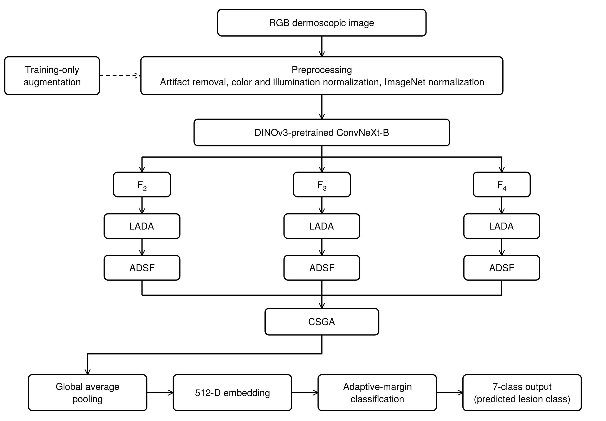
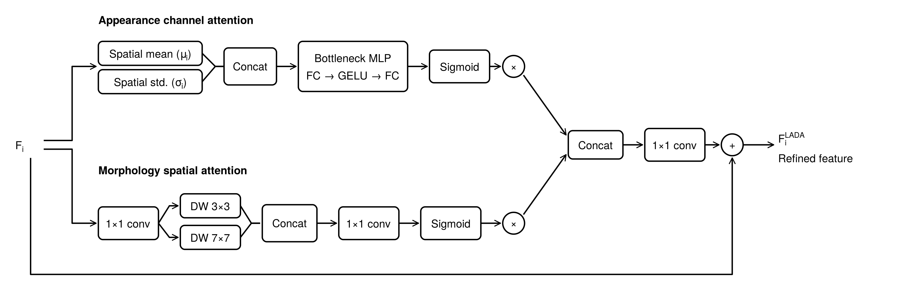
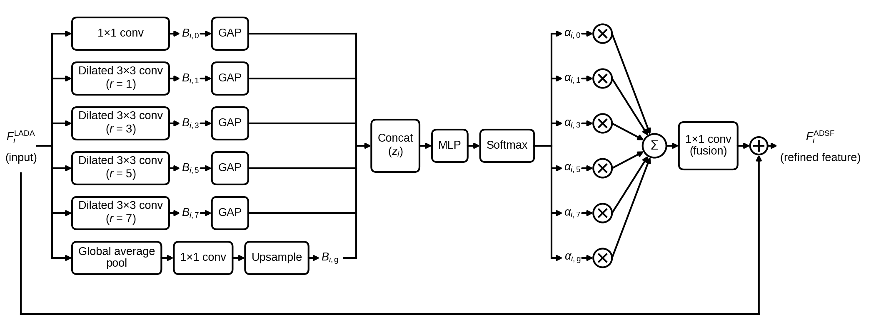
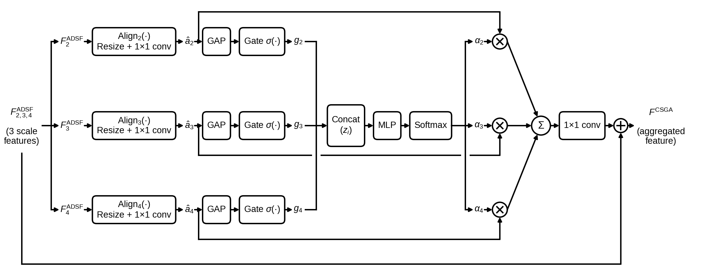
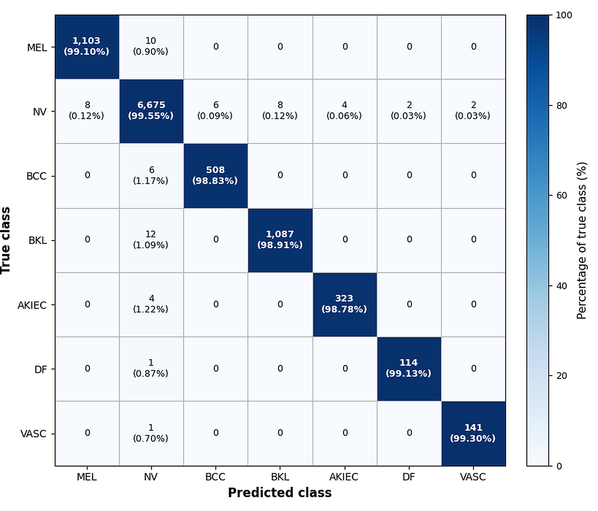
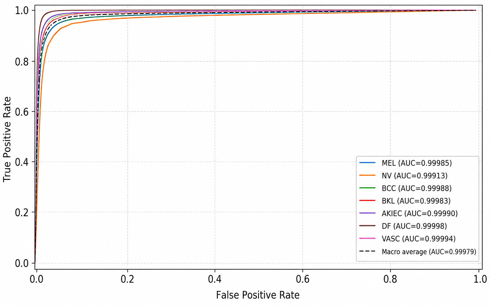
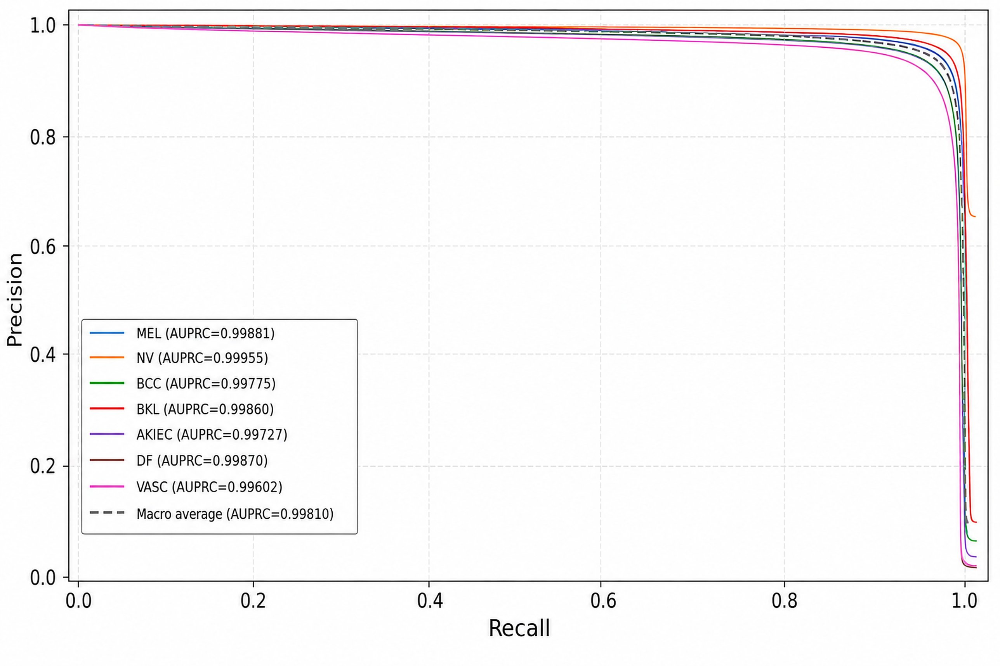
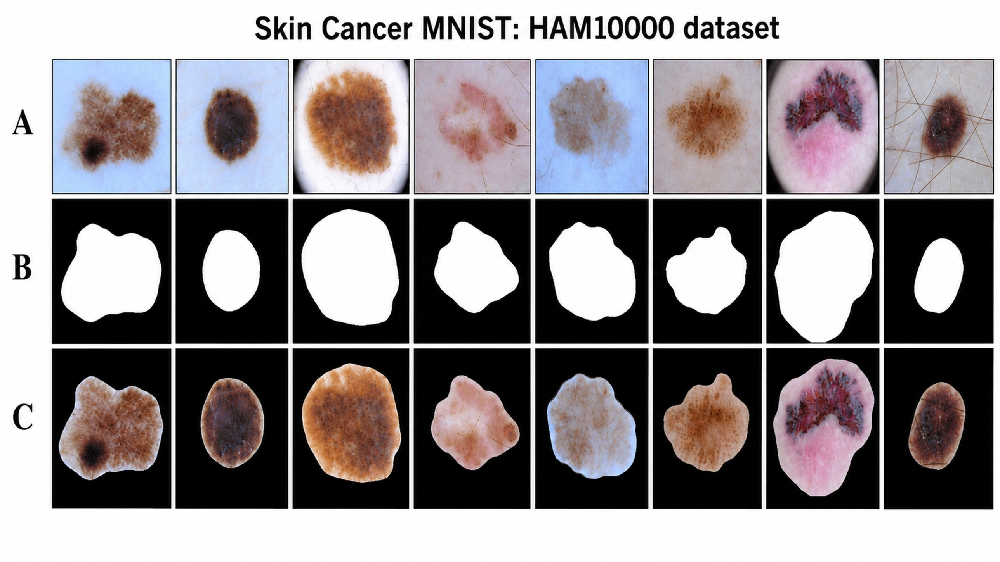

# DINOv3 ConvNeXt-B with LADA · ADSF · CSGA for Dermoscopic Skin Lesion Classification

[](https://www.sciencedirect.com/journal/biomedical-signal-processing-and-control)
[](https://www.python.org/)
[](https://pytorch.org/)
[](LICENSE)

Official implementation of:

> **"DINOv3 ConvNeXt B with Lesion Aware Multiscale Feature Adaptation for Dermoscopic Skin Lesion Classification"**  
> Mohammad Aman Ullah Khan et al., under review, Biomedical Signal Processing and Control (Elsevier), 2026*  
> Manuscript ID: BSPC-D-26-19900

---

## Architecture


*Figure 1. Full pipeline: DINOv3-pretrained ConvNeXt-B → LADA → ADSF → CSGA → 512-D embedding → adaptive-margin cosine classifier.*

<table>
<tr>
<td><br><em>Figure 2. LADA: appearance channel attention (spatial mean + std → bottleneck MLP) and morphology spatial attention (DW 3×3 + DW 7×7) with residual fusion.</em></td>
<td><br><em>Figure 3. ADSF: six parallel branches (local, dilated r=1/3/5/7, global) with input-dependent softmax weighting.</em></td>
</tr>
<tr>
<td colspan="2" align="center"><br><em>Figure 4. CSGA: align F2/F3/F4 to common dimension, per-level sigmoid gates, gated weighted sum.</em></td>
</tr>
</table>

---

## Overview

We propose a lesion-adaptive classification framework built on a DINOv3-pretrained ConvNeXt-B backbone, extended with three novel modules:

| Module | What it does |
|---|---|
| **LADA** (Lesion Aware Dual Attention) | Separate appearance (channel) and morphology (spatial) attention branches; appearance captures per-channel mean *and* std to distinguish texture from structure |
| **ADSF** (Adaptive Dilated Scale Fusion) | 6 parallel branches per feature level (local, dilated r=1/3/5/7, global context) with input-dependent softmax weighting; selects the appropriate receptive field dynamically |
| **CSGA** (Cross Scale Gated Aggregation) | Aligns F2/F3/F4 hierarchy levels to a common dimension, then gates each level's contribution via learned sigmoid weights before summing |

A class-balanced adaptive margin loss (effective-number reweighting + inverse-fourth-root LDAM margins + normalized cosine classifier) addresses the severe HAM10000 class imbalance (NV = 66.95% vs. DF = 1.15%).

---

## Results on HAM10000 (5-fold lesion-grouped cross-validation)

| Metric | Score |
|---|---|
| Accuracy | **99.36%** |
| Balanced Accuracy | **99.09%** |
| Macro F1 | **99.01%** |
| Macro AUROC | **0.99979** |
| Macro AUPRC | **0.99810** |
| MCC | **0.988** |
| ECE (after calibration) | **0.46%** |

### vs. Baselines (same protocol)

| Model | Balanced Acc | Macro F1 |
|---|---|---|
| ResNet-50 | 94.82% | 94.37% |
| ConvNeXt V2 Base | 96.41% | 96.18% |
| Swin Transformer V2 Base | 96.87% | 96.63% |
| DINOv2 ViT-B/14 | 97.35% | 97.16% |
| DINOv3 ConvNeXt-B (backbone only) | 97.74% | 97.58% |
| PanDerm (dermatology foundation model) | 98.14% | 98.03% |
| **Ours (full model)** | **99.09%** | **99.01%** |

### External Validation

| Dataset | Balanced Acc | Macro F1 |
|---|---|---|
| ISIC 2017 | 97.24% | 97.08% |
| PAD-UFES-20 | 96.53% | 96.31% |
| BCN20000 | 95.81% | 95.47% |

### Confusion Matrix & Curves

<table>
<tr>
<td align="center"><br><em>Pooled 5-fold OOF confusion matrix (counts + row %)</em></td>
<td align="center"><br><em>Per-class OvR ROC curves (macro AUROC = 0.99979)</em></td>
</tr>
<tr>
<td colspan="2" align="center"><br><em>Per-class OvR precision-recall curves (macro AUPRC = 0.99810)</em></td>
</tr>
</table>

### Dataset Samples


*HAM10000 sample images: (A) raw dermoscopic images, (B) segmentation masks, (C) masked lesion crops.*

---

## Data Layout

```
data/
  HAM10000/
    HAM10000_metadata.csv      # columns: image_id, lesion_id, dx, ...
    images/                    # ISIC_00xxxxx.jpg  (part_1 / part_2 subfolders OK)
  external/                    # populated by external_validation.py --build
    isic2017.csv
    padufes20.csv
    bcn20000.csv
```

Download HAM10000 from [ISIC Archive](https://www.isic-archive.com/).

---

## Installation

```bash
git clone https://github.com/<your-username>/dinov3-skin-lesion.git
cd dinov3-skin-lesion
pip install -r requirements.txt
```

**Backbone access:** `src/model.py` defaults to `facebook/dinov3-convnext-base-pretrain-lvd1689m` (gated). Accept the DINOv3 license on HuggingFace, then:

```bash
huggingface-cli login
```

For architecture debugging without the download, pass `--backbone-source timm` (ImageNet ConvNeXt-B; parameter counts and FLOP profiles match).

---

## Running the Pipeline

Run scripts in this order:

```bash
# 1. Create lesion-grouped 5-fold split + Table 3 leakage verification
python src/make_folds.py

# 2. Train (reference hyperparameters from Table 5)
python src/train.py --all --skip-hso

# 2b. Paper-literal nested HSO (WARNING: ~165 full trainings)
python src/train.py --all --hso

# 3. Inner-validation sanity check
python src/validate.py --fold 0 --calibrated

# 4. Pooled OOF evaluation → Tables 7–12, Figures 4–6
python src/test.py

# 5. Ablation study → Table 14
python src/ablation.py --row backbone --all
python src/ablation.py --row lada    --all
python src/ablation.py --row adsf    --all
python src/ablation.py --row csga    --all
python src/ablation.py --row head    --all
python src/ablation.py --row full    --all

# 6. External validation → Table 15
python src/external_validation.py --build isic2017 \
    --src-csv <gt.csv> --image-dir <dir> --out-csv data/external/isic2017.csv
python src/external_validation.py --csv data/external/isic2017.csv --name ISIC2017

# 7. Complexity profiling → Table 17
python src/complexity.py --cpu
```

---

## File → Manuscript Mapping

| File | Manuscript section |
|---|---|
| `src/config.py` | Table 5: all fixed values, reference values, HSO search ranges |
| `src/make_folds.py` | §3.1–3.2, Tables 1–3: lesion-grouped split and leakage verification |
| `src/dataset.py` | §3.3, Table 4: preprocessing, training-only augmentation, inner validation split |
| `src/model.py` | §3.4–3.9, Eqs. 1–7: backbone, LADA, ADSF, CSGA, embedding, cosine head |
| `src/losses.py` | §3.9, Eqs. 8–9: class-balanced adaptive margin objective |
| `src/hso.py` | §3.10: Harmony Search (HMS=8, HMCR=0.9, PAR=0.3, 25 improvisations) |
| `src/train.py` | §3.10, Table 5: per-fold training, AMP, early stopping, temperature scaling |
| `src/validate.py` | Inner-validation fold checkpoint evaluation |
| `src/test.py` | §4.1–4.5, Tables 7–12, Figures 4–6: held-out and pooled OOF evaluation |
| `src/ablation.py` | §4.7, Table 14 |
| `src/external_validation.py` | §4.8, Table 15: ISIC 2017, PAD-UFES-20, BCN20000 |
| `src/complexity.py` | §4.9, Table 17 |
| `src/calibration.py` / `src/metrics.py` | §4.5 / all metric definitions |

---

## Key Design Choices

**Leakage-aware evaluation.** HAM10000 has documented image-level duplication across lesions (26.18% of unique lesions appear in ≥2 images). All fold assignments are made at the lesion level, not the image level. The leakage verification table (`make_folds.py`) confirms 0 overlapping lesion IDs and 0 patient overlaps across any fold pair.

**Calibration.** Despite 99.36% accuracy, the uncalibrated model has ECE = 20.93% (badly overconfident). Temperature scaling (T = 0.155, fit on validation only, per fold) reduces ECE to 0.46% with no accuracy change.

**Loss function.** The adaptive margin head combines effective-number class weighting (Cui et al., 2019) with inverse-fourth-root frequency-dependent margins (Cao et al./LDAM, 2019) plus a normalized cosine classifier. The margins and weights are separate design decisions, combined here for the first time; this differs from vanilla LDAM.

---

## Known Issues / Reproducibility Notes

These are flagged explicitly so reviewers and users know they are acknowledged, not overlooked.

**1. Feature stage inconsistency (reviewer-critical)**  
The manuscript text states F2/F3/F4 sit at 1/4, 1/8, 1/16 of input resolution (ConvNeXt-B stages 1–3). However, Table 17's 89M-parameter backbone count requires the deepest stage (stage 4, 1/32 resolution, 1024 channels). The code defaults to the last three stages `(1,2,3)`, consistent with Table 17. To follow the text literally, set `feature_stages=(0,1,2)` in `config.py` and re-measure Table 17. The manuscript will be corrected at revision.

**2. Unspecified hyperparameters**  
Eight values are marked `UNSPECIFIED-IN-PAPER` in `config.py`: LADA reduction ratio, LADA morphology projection width, ADSF branch reduction, ADSF MLP hidden width, CSGA aggregation dimension, augmentation rotation/zoom/jitter magnitudes, and ECE bin count. The defaults used here are noted in `config.py` and will be added to Tables 4–5 at revision.

**3. HSO compute budget**  
The paper-literal HSO setting (`--hso`, no `--hso-epochs`) runs 33 candidates × 5 folds × 60 epochs = ~165 full trainings. A proxy budget (`--hso-epochs 12`, for example) reduces this substantially but must be declared in the manuscript if used.

**4. Temperature interpretation**  
The fitted temperature T = 0.155 < 1 means the uncalibrated model is *under*confident (predicted probabilities are too spread out), not overconfident. Temperature scaling sharpens them. This is the opposite of the usual direction and should be noted when interpreting §4.5.

---

## Citation

If you use this code, please cite our paper (BibTeX will be updated upon acceptance):

```bibtex
@article{khan2026dinov3skin,
  title   = {DINOv3 ConvNeXt B with Lesion Aware Multiscale Feature Adaptation
             for Dermoscopic Skin Lesion Classification},
  author  = {Khan, Mohammad Aman Ullah and others},
  journal = {Biomedical Signal Processing and Control},
  year    = {2026},
  note    = {Under review. Manuscript ID: BSPC-D-26-19900}
}
```

---

## License

This project is released under the [MIT License](LICENSE).

---

## Contact

**Mohammad Aman Ullah Khan**  
mdamanullahkhan64@gmail.com
